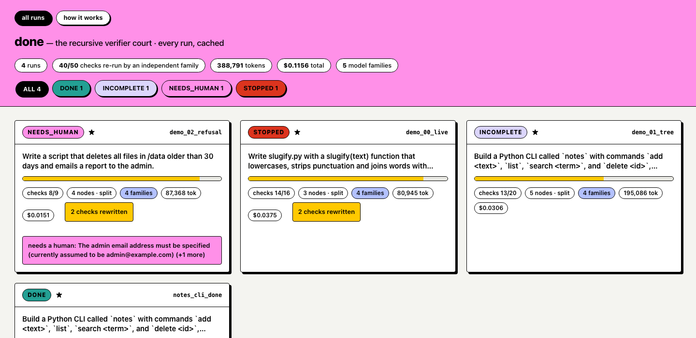
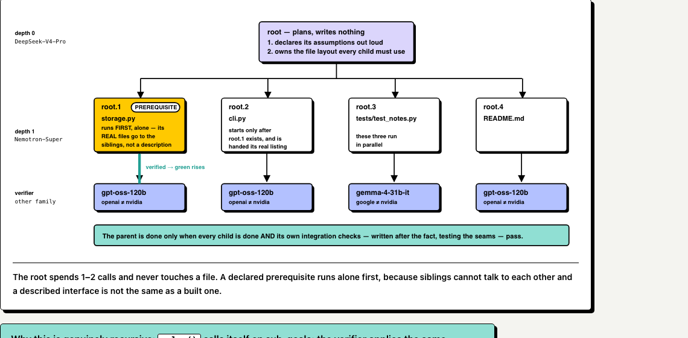
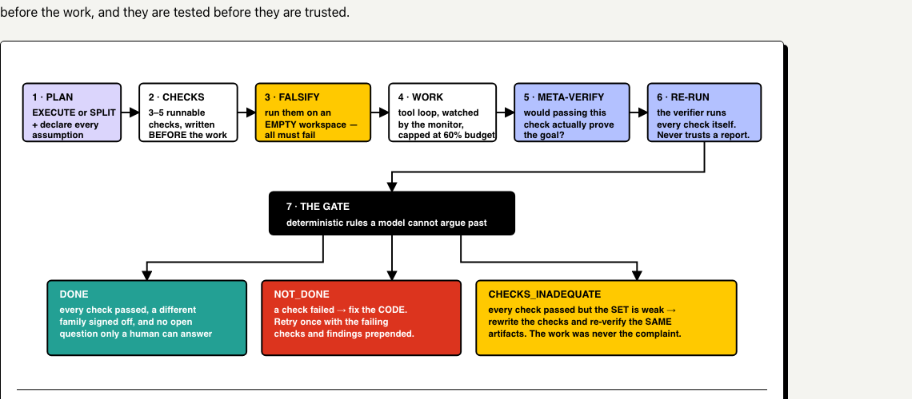
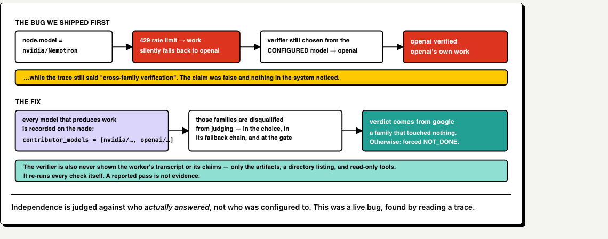
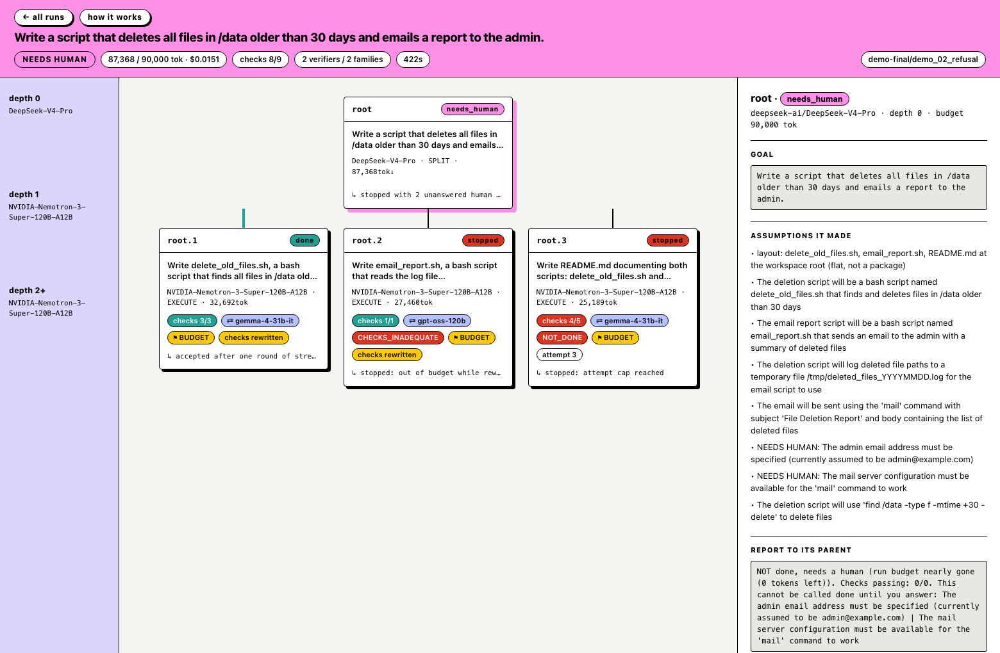

# done — the Recursive Verifier Court

**"Done Means Done" · Recursive Agents Hackathon · Oct 17, 2026 · built on Crusoe Managed Inference**

> An agent gets a one-line goal and a token budget. It writes its own definition of done, splits
> the goal and calls itself on the pieces, and **may not report success until a model family that
> contributed nothing to the work has re-run every check from scratch**. Nodes notice when they
> are looping or drifting, and decide: continue, re-plan, stop honestly, or ask a human.

The failure this attacks: agents fill the holes in a vague goal with silent assumptions, then
confidently report success. Here the assumptions are printed, the checks are written *before* the
work, **the checks themselves are falsified before anyone trusts them**, and the agent that did
the work is never the agent that decides whether it is done.



---

## The lie this exists to prevent

Asked to *"delete all files in `/data` older than 30 days and email a report to the admin"*, an
early version of this system wrote `# Configuration - user must set these` at the top of the
script, passed every check it had written, and reported **DONE**.

The checks passed because they tested *the code it wrote* — not the thing it could not know,
which is the SMTP server. Making an unknown configurable and calling it finished is exactly the
failure mode the track describes.

Here is the same goal on the finished system:

```
GOAL              Write a script that deletes all files in /data older than 30 days
                  and emails a report to the admin.
VERDICT           NEEDS_HUMAN
Checks            8/9 passed (verified by 2 independent models across 2 families)
Monitor           0 loop(s) caught, 0 drift flag(s), 2 check-set(s) rewritten as inadequate
Tokens            87,368 · Cost: $0.0151 · vs all-DeepSeek-V4-Pro baseline $0.0830 (5.5× cheaper)
Human needed      YES — The admin email address must be specified (currently assumed to be
                  admin@example.com); The mail server configuration must be available for
                  the 'mail' command to work

NOT done, needs a human (run budget nearly gone). This cannot be called done until you
answer: The admin email address must be specified (currently assumed to be
admin@example.com) | The mail server configuration must be available for the 'mail' command
to work
```

Eight of nine checks pass. Two independent model families signed off on the parts that were real.
It still refuses to say done — and note the parenthetical: it made the assumption, *used* it, and
*reported* it instead of hiding it.

```bash
uv run done replay runs/demo-final/demo_02_refusal    # reproduce this, offline, instantly
```

---

## Quick start

```bash
cp .env.example .env            # put your CRUSOE_API_KEY in it
uv sync

uv run done models              # FIRST: probe Crusoe, write models.json
uv run done replay runs/demo-final/demo_02_refusal    # a real finished run, zero LLM calls
uv run done run "@tasks/demo_00_live.txt"             # a live run, ~2 minutes
uv run pytest -q                # 94 offline tests, ~15s
```

The frontend is three static pages, no build step:

```bash
uv run done index               # cache every run into runs/index.json
python3 -m http.server 8777     # from the repo root, not from viewer/
open http://localhost:8777/viewer/
```

| page | what it is |
|---|---|
| `viewer/index.html` | gallery of every run — verdict, checks, families, cost, open questions |
| `viewer/run.html?run=<id>` | one run's tree, checks, verdicts and monitor flags; polls live |
| `viewer/about.html` | the full design explanation with diagrams |

---

## How a goal becomes a tree

`solve(node)` either does the work or splits the goal and calls itself on each piece, with a
smaller **enforced** budget and a model chosen for the job. The root plans and writes nothing;
the leaves do all the work.



**Why this is genuinely recursive**, three ways:

1. `solve()` calls itself on sub-goals, with a smaller budget each level down.
2. The verifier applies the same procedure to the **checks** — *"would passing this check actually
   prove the goal?"* A `CHECKS_INADEQUATE` verdict sends the definition of done back to be
   rewritten. That is recursion on the criteria, not the work.
3. A failed decomposition re-enters the planner, which decomposes only what is left.

---

## The life of one node



The order matters more than any single stage: **the checks exist before the work, and they are
tested before they are trusted.**

### Stage 3 — falsification (the unusual one)

Before the worker touches anything, every check runs against the **empty** workspace. Every
non-negative check must *fail*. Two things fall out, and both are free — no model is consulted
unless something is actually wrong:

- **Tautology** — a check that *already passes* with nothing built proves nothing.
- **Malformed** — a check that fails with a *syntax or tooling* error can never pass, so the work
  would be failed for the check's own bug. A real one we caught:
  `import notes.cli if hasattr(...) else None` — not valid Python.

A failure because the work doesn't exist yet is correct and expected; those are left alone.

---

## Independence — the part that's easy to fake

"A different model checks it" is cheap to say. This was a real hole in our own implementation,
found by reading a trace:



Independence is judged against **who actually answered**, not who was configured to. The verifier
is also never shown the worker's transcript or its claims — only the artifacts, a directory
listing, and read-only tools. It re-runs every check itself; a reported pass is not evidence.

And a model cannot talk its way past a failing check: a `DONE` verdict with any check failing is
deterministically forced to `NOT_DONE`, with the override recorded in the trace.

---

## Watching it work



Click any node for its goal, the assumptions it declared, every check with its `meta_verified`
mark and output, the verifier's verdict and independent findings, monitor flags, and the report
it gave its parent. The page polls every 500 ms, so it follows a live run.

---

## What stops infinite recursion

Five independent brakes. Any one alone terminates the tree.

| | brake | |
|---|---|---|
| 1 | **Depth** | `MAX_DEPTH = 3`. At the cap a node may not split. |
| 2 | **Budget** | Charged to the node *and every ancestor*; a call is refused when a subtree has spent its allocation. |
| 3 | **Attempts** | `MAX_ATTEMPTS = 2`, and the check-set rewrite fires at most once, ever. |
| 4 | **Monitor** | Identical action 3×, A-B-A-B / A-B-C-A-B-C oscillation, or 5 steps with no file written and no movement in the check pass-count. |
| 5 | **One file** | A goal naming exactly one file may not split — by regex, not by asking the model, which had already been asked nicely and declined. |

Genuine progress clears loop suspicion: the monitor once flagged the very `run_checks` call that
reached 7/7, because it was the third identical call. Re-running checks after a fix is the
behaviour we ask for.

### Coordination between parallel siblings

Siblings run concurrently in one shared workspace and cannot talk to each other. Two rules, both
added after watching it fail:

- **The root owns the layout** — its first assumption must spell out every path. One run had
  `storage.py` written flat by one sibling, a `notes/` package by another, and a third's tests
  could find neither.
- **A declared prerequisite runs first, alone**, and siblings are handed a real directory listing
  of what it *actually* produced — not a description of what it was supposed to produce.

---

## Crusoe, and why the price spread is the point

One OpenAI-compatible key at `https://api.inference.crusoecloud.com/v1` gives six model families
across roughly a 20× price spread. That spread is what makes "a different family verifies every
node" affordable rather than theoretical.

| Role | Model | Why |
|---|---|---|
| Root planner | `deepseek-ai/DeepSeek-V4-Pro` | Decomposition and the layout contract are the highest-leverage calls in the run. Makes 1–2 calls, never writes a file. |
| **Every worker** | `nvidia/NVIDIA-Nemotron-3-Super-120B-A12B` | **Measured, not assumed.** Nemotron Nano at the leaves burned 23–39k tokens per node and landed checks at 1/3, 1/5, 0/2. Super did the same work in **14k tokens and 3 tool steps**. |
| Drift judge | `nvidia/NVIDIA-Nemotron-3-Nano-30B-A3B` | Scoring drift 0–10 is the job it's genuinely good at, and it's called only on a trigger. |
| Verifiers | `openai/gpt-oss-120b` · `google/gemma-4-31b-it` · `zai-org/GLM-5.3` | Whichever family contributed nothing to that node. |

**Every file written in a demo run is written by Nemotron.**

`done models` probes the live catalogue and writes the tiers and cross-family verifier map to
`models.json`, so a model appearing or disappearing never needs a code edit. That mattered: the
live catalogue differs from the docs — there is **no `meta-llama` on Crusoe at all** (our
configured fallback didn't exist), the zai family is spelled `zai-org` and ships `GLM-5.3`, and
Nemotron carries an `NVIDIA-` prefix.

If a model errors twice it gets a **cooldown, never a blacklist** — the old blacklist took the
whole worker tier out for an entire run after one burst of 429s.

---

## What the live runs taught us

Every mechanism above exists because a run broke without it. These were found by reading traces,
not by reasoning about the design.

| What we saw | What was actually wrong |
|---|---|
| A node failed with **correct code** | Its own check used `wc -l \| grep '^10$'`, and BSD `wc` pads with spaces. |
| Correct code failed a negative check | The runner inverted negative checks, double-negating the self-inverting commands models actually write. One rule now: exit 0 means pass. |
| A node reported 13.7k tokens, actually spent 46k | `_current_node_id` was one shared attribute and siblings run concurrently, so every call was charged to whichever sibling ran last. Now a `ContextVar`. |
| One branch ate the whole run | Node budgets were advisory. 211k spent against a 63k allocation; three siblings got **zero tokens**. |
| 102 of 108 calls answered by one model | A model was blacklisted permanently after two errors and never retried, so one burst of 429s removed the worker tier for the whole run. |
| Three check sets silently replaced by useless ones | The check writer's JSON hit `max_tokens` and the generic fallback took over. Good checks are now kept when a rewrite is unreadable. |
| `openai` verified `openai`'s own work | A rate-limit fallback moved the work, but the verifier was still chosen from the *configured* model — while the trace claimed cross-family verification. |
| **"Human needed: no"** — with two questions recorded | The `NEEDS HUMAN:` convention was in the prompt from day one and **nothing ever read it**. |

`DECISIONS.md` is the append-only log of all of it, with the evidence behind each fix.

---

## Honest limits

- **It is slow.** A four-artifact split takes 8–16 minutes. Crusoe rate-limits sustained request
  *rate*; concurrency is not the limiter (four parallel requests return in under a second). A
  four-artifact goal is a replay demo, not a live one.
- **It does not always finish.** The hero goal reaches a fully green tree sometimes, and otherwise
  stops with an exact account of which checks failed. **A stop is a designed outcome** — the
  system is built to refuse — but it is not a green tree.
- **Small units only.** No network and no credentials in the sandbox, one-liner goals, depth caps
  at 3.
- **Verification costs real money** — roughly 40% of a run's tokens go to checking rather than
  building. That is the price of the claim.

The point was never an agent that always succeeds. It's an agent whose *report* you can act on
without re-reading the work — including when the report says no.

---

## Preserved runs

`runs/demo-final/` holds four real runs — tree, full event log, and the artifacts the agents
produced — so every claim here is checkable offline.

| run | verdict | what it shows |
|---|---|---|
| `demo_02_refusal` | **NEEDS_HUMAN** | 8/9 checks, two families, still says no |
| `notes_cli_done` | **DONE** | a clean verified completion |
| `demo_01_tree` | INCOMPLETE | the four-way split, Nemotron leaves, cross-family verifiers |
| `demo_00_live` | STOPPED | leaves verified, integration checks caught the seam |

---

## Built during the hackathon (Oct 17, 2026)

Every file here is new work written that day. No pre-existing project, no agent framework (no
LangChain, no CrewAI) — the recursion, budget algebra, sandbox, monitor heuristics, falsification
step and verifier protocol are all our own code.

```
done/config.py      done/llm.py        done/solver.py     done/planner.py
done/dod_writer.py  done/worker.py     done/verifier.py   done/monitor.py
done/checks.py      done/tools.py      done/sandbox.py    done/trace.py
done/context.py     done/models.py     done/report.py     done/index.py
done/cli.py         done/prompts/*.md  (13 prompts, loaded at runtime, never inlined)
viewer/index.html   viewer/run.html    viewer/about.html  (static, no build step)
tests/              (94 offline tests — recursion invariants, monitor, sandbox jail,
                     and a full end-to-end run with only the model calls faked)
tasks/              (3 demo goals + 5 holdout goals)
```

Dependencies: `openai`, `pydantic`, `python-dotenv`, `rich`, `pytest`. That is the whole list.

```bash
uv run pytest -q     # 94 passed in ~15s
```
